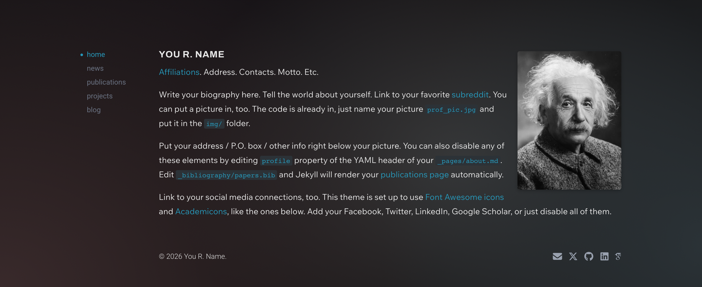

# Personal Website Template

A personal-website **template** built on [al-folio](https://github.com/alshedivat/al-folio) v1 — the pluginized starter whose runtime lives in `al_folio_core` and sibling gems — redesigned with a minimal look: left-sidebar navigation, a dark color scheme, sans-serif body text, plain list pages, and a slim footer.

This repo deliberately keeps al-folio's placeholder content (demo socials, sample posts, projects, and publications) so it can be instantiated as a new site: copy it, then work through the [Make it yours](#make-it-yours) checklist. al-folio itself is documented [upstream](https://github.com/alshedivat/al-folio#readme) and in [`docs/`](docs/README.md); this README documents only how this template **differs** from stock al-folio.



## Modifications from stock al-folio

### Navigation

Site-local override of `_includes/header.liquid`:

- Vertical left sidebar with a small set of top-level links — home / news / publications / projects / blog — and an accent-colored dot marking the active page. On narrow viewports (below 1100px) it becomes a slim sticky bar — a hamburger button plus the current page name — that slides open a left drawer with the same links, driven by the gem's existing `nav-toggle.js` (no site-local JavaScript).
- Any page can set `nav_title` in its front matter to change its nav label without changing its title: the about page shows as **home** and the what's-new page as **news**. Order follows `nav_order`, with the about page always first.
- Removed: the site-title brand link, search button, dark-mode toggle, dropdown submenus, and the scroll progress bar.
- A new site-local `site_theme: light | dark` key in `_config.yml` sets the color scheme site-wide (no visitor toggle). The template ships with `dark`.
- Which of publications / projects / blog show in the nav is set in `_config.yml` via `nav_visibility` (per-page `true`/`false`), so a page can be hidden without touching its front matter (the about page is always shown). The other stock pages (`books`, `cv`, `dropdown`, `plugins`, `profiles`, `repositories`, `teaching`) stay hidden via `nav: false`.

### Footer

Site-local override of `_includes/footer.liquid`: a slim single flowing row at the end of the content column — copyright on the left, social icons on the right — replacing the gem's fixed strip, newsletter form, and impressum/last-updated variants.

### Typography & color

Site-local rules appended to `assets/css/main.scss` (loaded after the gem imports, so they win the cascade):

- Wix Madefor Text body copy, with PT Serif as the fallback; Roboto for headings, nav, dates, and footer; Archivo bold for the name heading and the blog list titles. All are loaded through the single Google Fonts pin in `_config.yml`, which now uses the CSS2 API.
- Dark mode keeps the gem's palette (including its cyan accent) apart from the background: a darker page color (`#121212`) over a fixed backdrop of soft color blobs with a faint grain, imitating a translucent blurred terminal window (the mobile nav bar and drawer are frosted to match). Light mode has gray body text, black headings, and a green accent for links and the active nav item. Both use a 1.75 body line-height and antialiased font smoothing.
- The site owner's name is a small bold uppercase masthead at the top of every nav page (see [Pages](#pages)); section headings are smaller, and the profile image is shrunk to 3/4 of the gem default.
- On the wide sidebar layout the content column and the nav rail start 6rem down instead of the gem's 3rem. Narrow viewports keep 3rem.

### Pages

- Page heading — a net-new site-local include, `_includes/page_heading.liquid`, renders the site owner's name as the heading on the news, publications, projects, and blog pages, matching the about page. The highlighted sidebar item identifies the section; the browser-tab title still comes from each page's `title:`.
- `_pages/about.md` — stripped down: selected papers, the address block, and the social-icons row are disabled (the footer shows socials site-wide), as are the stock _news_ and _latest posts_ sections. The name renders in a single weight, and the profile photo's top edge lines up with it. An optional **what's new** section (below) is off by default.
- `_pages/blog.md` — rewritten as one row per post on a single page: title on the left, date on the right, hairline dividers, newest first. Pagination, descriptions, thumbnails, read times, tag/category lists, and the featured-posts block are removed.
- `_pages/projects.md` — rewritten as a plain bulleted list of linked project titles, newest first (via a new `date:` front-matter field on each project), replacing the gem's work/fun grouped grid. Thumbnails, descriptions, and categories are not rendered.
- `_pages/publications.md` — the bibliography search box is disabled and the year-group headers are hidden, giving one continuous list. On phones the citation and preview stay side by side instead of stacking.
- External links in the blog, projects, and news lists open in a new tab and carry a compact inline outbound-arrow icon.

### "What's new" feed

A net-new site-local include, `_includes/whats_new.liquid`, replaces al-folio's separate _news_ and _latest posts_ sections (and the standalone `/news/` page, now removed) with one merged feed, newest first:

- `_pages/whats-new.md` (`/whats-new/`): the full merged history of posts + announcements, linked second in the sidebar as **news** via its `nav_title` front matter. Blog posts are tagged `blog`; announcements are untagged; inline announcements render in place.
- On the about page (optional): a compact `date · tag · title` list (7 most recent) under a **what's new** heading linking to the full page. Toggle it with `whats_new.enabled` in `_config.yml` (off by default here; the feed lives on its own page instead).

### Config (`_config.yml`)

- `navbar_fixed`, `footer_fixed`, `search_enabled`, `enable_darkmode`, and `enable_progressbar` are all off to match the nav/footer overrides. `enable_progressbar` must stay off: its script probes the `#navbar` element the override removes.
- `site_theme: dark` sets the color scheme, and `icon: 🧠` sets the emoji favicon.
- `_data/socials.yml` is trimmed to email / X / GitHub / LinkedIn / Google Scholar, with TODO placeholder values.
- Site-local toggles: `site_theme` (color scheme), `nav_visibility` (per-page nav show/hide), per-page `nav_title` (nav-only link label) and `whats_new.enabled` (the about-page what's-new section). Being `_config.yml` values, changes need a Jekyll **restart** to take effect — a plain `--watch` rebuild won't reload config (the Docker setup restarts automatically).

### Override governance

- All three local overrides (`_includes/header.liquid`, `_includes/footer.liquid`, `assets/css/main.scss`) are tracked in `.al-folio-overrides.yml` (via `bundle exec al-folio upgrade overrides audit`), so upstream drift is flagged on gem updates.
- `test/style_contract.js` allowlists the only local `_includes/` files — the `header.liquid` / `footer.liquid` gem overrides plus the net-new `whats_new.liquid` and `page_heading.liquid` — everything else stays gem-owned.

### CI & tests

- The upstream v0.16.3 visual-parity suite was retired — this site intentionally diverges from stock al-folio. Interaction/stability visual tests still run.
- CodeQL is manual-only (code scanning can't upload results on a private repo).
- The deploy workflow adds `_site/.nojekyll` so GitHub Pages serves the built output instead of re-running Jekyll.

## Getting started

Prefer GitHub's **"Use this template"** over forking (a fork keeps a link to this repo, making accidental upstream PRs easy). Then:

```bash
git clone <your-copy> && cd <your-copy>
bundle install
npm ci                    # linters + visual tests
bundle exec jekyll serve  # → http://localhost:4000/<baseurl>/
```

Or with Docker (no local Ruby needed): `docker compose up -d`, then open `http://localhost:8080/<baseurl>/`.

See [`docs/INSTALL.md`](docs/INSTALL.md) for full setup (deployment, Python extras, ImageMagick) and [`docs/QUICKSTART.md`](docs/QUICKSTART.md) for a guided tour.

## Make it yours

- [ ] `_config.yml` — `url`, `baseurl`, name fields, site metadata, the `icon` favicon, and `site_theme` (`light` or `dark`).
- [ ] `_data/socials.yml` — replace the TODO placeholder handles.
- [ ] `_pages/about.md` — your bio, plus `assets/img/prof_pic.jpg`.
- [ ] Replace the sample content in `_posts/`, `_news/`, `_projects/` (keep the `date:` field for ordering), and `_bibliography/papers.bib`.
- [ ] Optionally show/hide nav pages via `nav_visibility` in `_config.yml`, toggle the what's-new section with `whats_new.enabled`, or restore dropped gem features (each override file's header comment documents what it removed; delete the file to revert). If you change or add overrides, re-run the overrides audit and commit `.al-folio-overrides.yml`.

## Documentation

| Topic                                  | Where                                                                                                       |
| -------------------------------------- | ----------------------------------------------------------------------------------------------------------- |
| Theme setup, customization, FAQ        | [`docs/`](docs/README.md) and the [upstream al-folio README](https://github.com/alshedivat/al-folio#readme) |
| Starter-vs-plugin ownership boundaries | [`docs/BOUNDARIES.md`](docs/BOUNDARIES.md)                                                                  |
| Guidance for coding agents             | [`AGENTS.md`](AGENTS.md) / [`CLAUDE.md`](CLAUDE.md)                                                         |

## License & attribution

MIT — see [LICENSE](LICENSE). Based on [al-folio](https://github.com/alshedivat/al-folio) by Maruan Al-Shedivat and contributors.
